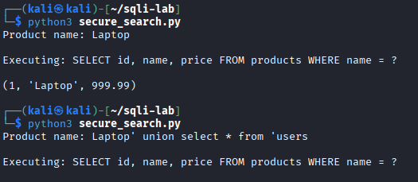

# SQL Injection Exploitation and Remediation — Application Security Investigation

## Executive Summary

This investigation documents an authorized SQL injection security exercise involving vulnerable database queries, information disclosure, and application-level remediation.

The investigation included examining SQL injection behavior, using UNION-based queries to retrieve database information, enumerating database structure, and independently testing vulnerable Python application code.

The independent security assessment extended the guided exercise by examining how unsafe SQL query construction could permit user-controlled input to alter database operations.

The remediation phase focused on parameterized queries and validation of the modified application behavior.

The objective was to demonstrate practical application security analysis, controlled vulnerability testing, secure database access, and evidence-based remediation.

## Investigation Scenario

A database-backed application processes user input and constructs SQL queries to retrieve information.

When an application incorporates untrusted input directly into SQL statements, an attacker may be able to manipulate the intended query structure.

The investigation examines this vulnerability class in an authorized training environment.

The guided exercises explore SQL injection techniques and their potential effects on database confidentiality.

The independent investigation focuses on identifying vulnerable query construction in Python and applying a safer database-query implementation.

This report documents the observed results of controlled testing rather than exploitation of a production application.

## Investigation Scope

| Component | Investigation Purpose |
| --- | --- |
| SQL database | Examine query execution and database responses |
| UNION-based SQL injection | Investigate unintended data extraction |
| Database schema enumeration | Identify accessible database structure |
| Python application code | Analyze vulnerable SQL query construction |
| User-controlled input | Examine how untrusted values affect queries |
| Parameterized queries | Separate SQL instructions from supplied data |
| Independent validation | Compare vulnerable and remediated behavior |
| Screenshot evidence | Support technical findings and conclusions |

### Investigation Objectives

1. Examine the SQL injection scenario and affected database operations.

2. Demonstrate UNION-based data extraction in the authorized environment.

3. Investigate database schema enumeration.

4. Identify the security implications of exposed database information.

5. Analyze vulnerable SQL query construction in Python.

6. Perform an independent SQL injection test.

7. Modify the vulnerable code using parameterized queries.

8. Compare observed behavior before and after remediation.

9. Document remaining limitations and applicable secure coding practices.

## Evidence Sources and Methodology

### Evidence Sources

The investigation uses four screenshots collected during the original IBM security exercises and independent testing.

The preserved project notes provide the scenario, exercise instructions, investigation activities, and observed results.

### Investigation Methodology

| Phase | Analyst Activity |
| --- | --- |
| Vulnerability analysis | Examine unsafe SQL query construction |
| Controlled exploitation | Test UNION-based SQL injection behavior |
| Information disclosure assessment | Review retrieved data and database structure |
| Independent testing | Evaluate vulnerable Python application code |
| Remediation | Apply parameterized database queries |
| Verification | Compare vulnerable and remediated results |
| Reporting | Document findings, security implications, and evidence limitations |

### Evidence Standards

All testing was conducted in an authorized lab environment.

The investigation distinguishes between the behavior demonstrated during testing and broader risks associated with SQL injection.

A successful SQL injection test does not independently establish that the same technique would work against other databases or applications.

Likewise, parameterizing the tested query does not establish that an entire application is free of SQL injection vulnerabilities.

The technical findings will be supported by the preserved screenshots and independent exercise documentation.

## Investigation Organization

The report will document four findings:

1. UNION-Based SQL Injection and Data Extraction

2. Database Schema Enumeration

3. Independent SQL Injection Exploitation

4. Parameterized Query Remediation and Validation

The final sections will summarize security implications, remediation outcomes, evidence limitations, skills demonstrated, and supporting screenshots.

## Investigation Findings

### Finding 1 — UNION-Based SQL Injection and Data Extraction

#### Investigation Context

The IBM SQL injection exercise simulated an online store with a product search feature backed by a MySQL database.

The lab environment contained two tables:

- `products` — Product names, descriptions, and prices.

- `users` — Usernames, passwords, and email addresses.

The objective was to demonstrate how unsafe SQL query construction could allow information from the `users` table to appear in a query intended to retrieve product information.

The exercise used the database `vulnerable_db` and the phpMyAdmin SQL interface.

#### Vulnerable Query Construction

The lab described a product search query that incorporated user-controlled input directly into a SQL statement:

```sql
SELECT * FROM products WHERE name = '$productName';
```

When untrusted input is concatenated into the SQL statement without proper parameterization, it can potentially change the intended query structure.

The lab supplied a UNION-based injection example that appended a second SELECT statement targeting the `users` table.

The preserved screenshot showed the following query executed in phpMyAdmin:

```sql
SELECT name, description, price
FROM products
WHERE name = 'Laptop'
UNION
SELECT username, password, email
FROM users;
```

The query combined three selected columns from the `products` table with three columns from the `users` table.

Both SELECT statements returned the same number of columns, allowing their results to be combined.

#### Observed Query Results

The screenshot displayed the message:

**Showing rows 0 - 3 (4 total, Query took 0.0007 seconds.)**

The results contained one product record and three user records.

| Result Type | First Column | Second Column | Third Column |
| --- | --- | --- | --- |
| Product | `Laptop` | High performance laptop | `999.99` |
| User | `alice` | `password123` | `alice@example.com` |
| User | `bob` | `qwerty` | `bob@example.com` |
| User | `charlie` | `letmein` | `charlie@example.com` |


*Figure 1 — phpMyAdmin results showing a UNION-based query combining product information with three user records from the `users` table.*

The displayed columns retained the labels `name`, `description`, and `price` from the first SELECT statement.

However, the later rows contained data from the `users` table.

As a result, the `description` column displayed passwords and the `price` column displayed email addresses for those rows.

The screenshot confirmed that the SQL statement returned user information alongside product information.

#### Security Impact Analysis

The result illustrated how UNION-based SQL injection can compromise database confidentiality when an application permits untrusted input to alter SQL statements.

A product lookup should not ordinarily expose authentication-related records from a separate user table.

In the demonstrated query, the UNION operation allowed data from `users` to appear in the product-query result set.

The lab's example database stored passwords in plaintext, increasing the sensitivity of the disclosed records.

A production application should store passwords using an appropriate password-hashing algorithm rather than plaintext.

The exercise also highlighted why database permissions matter.

An application database account should not possess unnecessary access to sensitive tables.

Restricting database privileges can limit the potential impact of certain injection vulnerabilities, although it does not replace secure query construction.

#### Evidence Interpretation

The preserved screenshot was captured from phpMyAdmin.

It directly established that the combined SQL query executed and returned four rows, including three records from the `users` table.

The screenshot did not show a browser-based product search form, an HTTP request carrying an injection payload, or the application's query-construction code.

Therefore, the observed result demonstrates the database behavior underlying the lab's UNION-based SQL injection scenario.

It should not be interpreted as independent proof of exploitation through a deployed web application's input field.

#### Analyst Assessment

**Assessment: UNION-based SQL query successfully returned user information alongside product data in the authorized MySQL lab.**

The query returned four rows, including one product record and three user records containing usernames, plaintext passwords, and email addresses.

This demonstrated the confidentiality impact that could result if a vulnerable application allowed user input to alter the intended product-search query.

The preserved screenshot confirms database query behavior; it does not independently establish application-level injection delivery.

The next finding examines database schema enumeration and the information that can be discovered about underlying database structures.

### Finding 2 — Database Schema Enumeration

#### Investigation Context

Following the UNION-based data extraction exercise, the next phase examined how database metadata could be retrieved using a similar SQL technique.

The objective was to identify database tables through the MySQL `INFORMATION_SCHEMA` metadata interface.

The exercise used the existing `vulnerable_db` database, containing the `products` and `users` tables.

The security concern was that knowledge of internal database structure could help an attacker identify potentially sensitive data sources.

#### Database Metadata Enumeration

MySQL provides the `INFORMATION_SCHEMA` database, which contains metadata describing database objects, including tables and columns.

The `information_schema.tables` view exposes information about database tables visible to the querying account.

The original exercise demonstrated how a UNION operation could combine ordinary application data with table names retrieved from this metadata view.

The preserved screenshot displayed the following statement in phpMyAdmin:

```sql
SELECT name, description, price
FROM products
WHERE name = 'Laptop'
UNION
SELECT table_name, NULL, NULL
FROM information_schema.tables
WHERE table_schema = 'vulnerable_db';
```

The first SELECT statement retrieved information from the `products` table.

The second SELECT statement retrieved table names from `information_schema.tables`, restricted to the `vulnerable_db` schema.

The UNION operator combined the two result sets.

Both SELECT statements returned three expressions, preserving column-count compatibility.

The two NULL expressions acted as placeholders for the second and third output columns.

#### Observed Enumeration Results

The phpMyAdmin interface displayed:

**Showing rows 0 - 2 (3 total, Query took 0.0023 seconds.)**

The query returned three rows:

| Result Type | Name | Description | Price |
| --- | --- | --- | --- |
| Product record | `Laptop` | High performance laptop | `999.99` |
| Database table | `products` | NULL | NULL |
| Database table | `users` | NULL | NULL |


*Figure 2 — phpMyAdmin showing a UNION-based query against `information_schema.tables`, revealing the `products` and `users` tables in database `vulnerable_db`.*

The first row contained the expected product information.

The remaining two rows disclosed table names from the target database.

The result demonstrated that metadata about the database structure could be included in the output of a query originally intended to retrieve product information.

The identified tables were:

- `products` — the application's product information table.

- `users` — the table containing user account information in the lab environment.

The screenshot did not display column names or the internal definitions of either table.

#### Security Impact Analysis

Database schema enumeration can assist an attacker in understanding how an application stores and organizes information.

Identifying a `users` table may indicate that authentication-related or account-related information is present in the database.

Knowledge of table names can inform additional testing for unauthorized data access.

In this exercise, enumeration was particularly relevant because Finding 1 demonstrated that the `users` table contained usernames, plaintext passwords, and email addresses.

Together, the two findings illustrated how an unsafe query interface could expose both database records and structural metadata.

However, knowing a table name does not automatically grant access to its contents.

The actual impact of SQL injection depends on the vulnerable query, database permissions, application behavior, and accessible database objects.

#### Evidence Interpretation

The screenshot was captured in phpMyAdmin, where the UNION-based SQL statement was executed directly.

It established that the query returned metadata identifying the `products` and `users` tables within `vulnerable_db`.

The screenshot did not independently show the SQL statement being injected through a web application input field.

It also did not establish that additional schemas, tables, or columns were enumerated.

The result therefore demonstrates database metadata disclosure through the executed SQL statement, consistent with the lab's SQL injection scenario.

#### Defensive Considerations

The exercise highlighted several important application security controls.

**Parameterized queries**

Applications should treat user-supplied values as data rather than allowing them to alter SQL syntax.

Proper parameterization is the primary remediation for SQL injection in supported query contexts.

**Least-privilege database access**

Application database accounts should receive only the permissions required for their intended operations.

Restricting unnecessary database access can reduce the impact of a successfully exploited vulnerability.

**Error and response handling**

Applications should avoid unnecessarily exposing internal database details in user-facing errors or responses.

However, suppressing errors alone does not prevent SQL injection.

**Secure application testing**

Security testing should examine whether user-controlled input can alter SQL query structure.

Database schema enumeration may be one indicator that a query is executing unintended SQL instructions.

#### Analyst Assessment

**Assessment: UNION-based SQL query disclosed the names of two tables in the authorized MySQL lab database.**

The preserved screenshot showed a successful query against `information_schema.tables`, restricted to schema `vulnerable_db`.

The output contained three rows: the original `Laptop` product record and the table names `products` and `users`.

This demonstrated how database metadata could be retrieved through a UNION-based query.

The screenshot confirmed direct database query execution, but did not independently prove injection through a deployed application's input field.

The next investigation phase examines independent testing against vulnerable Python application code.

### Finding 3 — Independent SQL Injection Exploitation

#### Investigation Context

After completing the guided SQL injection exercises, I developed a separate local Python application to independently reproduce the vulnerability.

The objective was to determine whether unsafe SQL query construction could allow user-controlled input to alter database query logic and access unintended records.

This investigation used a deliberately vulnerable Python script, a local SQLite database, and interactive terminal input.

Unlike the guided phpMyAdmin exercises, the independent application accepted a product name from the user and incorporated that value into a SQL statement.

This allowed direct testing of the application's input-handling behavior.

#### Independent Lab Environment

The test environment consisted of:

| Component | Configuration |
| --- | --- |
| Operating environment | Kali Linux |
| Application language | Python |
| Database engine | SQLite |
| Vulnerable application | `vulnerable_search.py` |
| Application input | Interactive product-name prompt |
| Intended database table | `products` |
| Additional database table | `users` |
| Vulnerable behavior | Dynamic SQL construction using an f-string |

The application was designed to retrieve a product record based on a supplied name.

The local database also contained user records for evaluating the impact of unauthorized data retrieval.

#### Vulnerable SQL Query Construction

The Python application constructed its SQL statement using an f-string:

```python
query = f"SELECT id, name, price FROM products WHERE name = '{search}'"
```

The variable `search` contained the value supplied at the product-name prompt.

Because the value was inserted directly into the SQL statement, characters supplied by the user could become part of the executable query syntax.

The application did not separate user-controlled data from SQL instructions.

This unsafe query-construction pattern was the root cause of the vulnerability.

#### Test 1 — Boolean-Based SQL Injection

The first test used a Boolean condition to alter the product query.

I executed the application:

```bash
python3 vulnerable_search.py
```

At the prompt, I supplied:

```text
Laptop' or '1 = 1
```

The application displayed the constructed query:

```sql
SELECT id, name, price
FROM products
WHERE name = 'Laptop' or '1 = 1'
```

The condition `'1 = 1'` evaluates to true.

As a result, the WHERE clause no longer restricted the query to the requested laptop record.

The terminal returned:

```text
(1, 'Laptop', 999.99)
(2, 'Smartphone', 699.99)
(3, 'Tablet', 299.99)
```

The application returned all three product records.

This confirmed that user-controlled input successfully changed the query's selection logic.

#### Test 2 — UNION-Based SQL Injection

The second test investigated whether the vulnerable application could retrieve records from the `users` table.

I ran the same application again and supplied:

```text
Laptop' union select * from 'users
```

The resulting SQL statement was:

```sql
SELECT id, name, price
FROM products
WHERE name = 'Laptop' union select * from 'users'
```

The injected UNION operation combined the product query with a SELECT statement targeting the `users` table.

In this test database, both SELECT statements returned three columns, allowing the result sets to be combined.

The terminal displayed:

```text
(1, 'Laptop', 999.99)
(1, 'alice', 'password123')
(2, 'bob', 'qwerty')
(3, 'charlie', 'letmein')
```

The first row contained the requested product.

The remaining three rows contained user account information from the additional table.

This demonstrated that the vulnerable application retrieved records outside the intended product-search scope.


*Figure 3 — Kali Linux terminal showing two successful SQL injection tests against `vulnerable_search.py`: Boolean-based query manipulation returning all products and UNION-based extraction revealing three user records.*

#### Evidence Interpretation

The screenshot documented two successful executions of `vulnerable_search.py`.

The first execution demonstrated Boolean manipulation of a SQL WHERE clause.

The second demonstrated UNION-based extraction of user records from a separate database table.

The displayed SQL statements were consistent with direct interpolation of the supplied input values.

Unlike the earlier guided phpMyAdmin screenshots, this evidence showed the injection values being entered into an application prompt and subsequently affecting the application's query results.

The evidence supports successful exploitation of the deliberately vulnerable local Python application.

The screenshot did not establish exploitation of an externally hosted service, a production database, or an HTTP-based web application.

#### Security Impact Analysis

The independent tests demonstrated two distinct effects of unsafe SQL query construction.

**Query logic manipulation**

The Boolean-based input caused the application to return records beyond the requested product.

This demonstrated how user input could change the meaning of an application's database query.

**Unauthorized data retrieval**

The UNION-based input caused the application to retrieve usernames and plaintext passwords from the `users` table.

This illustrated the potential confidentiality impact of SQL injection when an application's database connection can access sensitive records.

In a production environment, the consequences could include disclosure of sensitive information or other unauthorized database operations, depending on the database account's permissions and the vulnerable query context.

The test database used plaintext passwords for demonstration purposes. Production applications should use appropriate password-hashing mechanisms.

#### Root Cause Analysis

The vulnerability originated from constructing executable SQL statements with untrusted user input.

The affected pattern was:

```python
query = f"SELECT id, name, price FROM products WHERE name = '{search}'"
```

The application treated the supplied product name as part of the SQL source text.

Because the input was not parameterized, SQL operators and expressions supplied by the user could modify the intended query.

The resulting behavior was demonstrated by:

1. An always-true condition causing the query to return every product.

2. A UNION operation causing the query to retrieve records from the `users` table.

The next phase focuses on preventing these behaviors using parameterized SQL queries.

#### Analyst Assessment

**Assessment: SQL injection vulnerability independently reproduced in a local Python and SQLite application.**

The first test demonstrated that Boolean-based input modified the product search query and returned all three product records.

The second test demonstrated that UNION-based input retrieved three user records containing usernames and plaintext passwords.

The screenshot confirmed that both payloads were supplied through the application's interactive product-name prompt and affected the resulting SQL queries.

The root cause was direct interpolation of untrusted input into executable SQL statements.

This established a reproducible vulnerable baseline for the remediation and retesting documented in Finding 4.

### Finding 4 — Parameterized Query Remediation and Validation

#### Investigation Context

Following the successful exploitation of the deliberately vulnerable Python application, the final phase focused on remediating the root cause and verifying that the original SQL injection technique no longer worked.

The independent investigation had demonstrated that an application using Python string interpolation to construct SQL statements could allow user-controlled input to modify query behavior.

The Boolean-based test returned records outside the intended product search.

The UNION-based test retrieved usernames and plaintext passwords from the separate `users` table.

The remediation objective was to prevent user input from altering the SQL statement while preserving legitimate application functionality.

#### Vulnerable Application Review

The original application used the following query-construction pattern:

```python
query = f"SELECT id, name, price FROM products WHERE name = '{search}'"
```

The variable `search` contained user-supplied input.

Because the input was inserted directly into the SQL statement, the application interpreted SQL expressions provided by the user as part of its query syntax.

This allowed the original UNION-based injection to retrieve records from the `users` table.

The root cause was unsafe SQL construction rather than the use of SQLite itself.

#### Remediation Implementation

I created a separate secure version of the application named:

`secure_search.py`

The vulnerable query construction was replaced with a parameterized SQL statement:

```python
query = "SELECT id, name, price FROM products WHERE name = ?"
cursor.execute(query, (search,))
```

The `?` placeholder represented a bound parameter.

The database driver received the SQL statement and user-supplied search value separately.

This prevented characters contained in the product-name input from being interpreted as additional SQL operators or statements.

The remediation preserved the original application objective: retrieve a product matching the supplied name.

#### Validation Test 1 — Legitimate Product Search

After implementing parameterization, I tested the application using a normal product name.

I executed:

```bash
python3 secure_search.py
```

At the product-name prompt, I entered:

```text
Laptop
```

The application displayed the parameterized SQL statement:

```sql
SELECT id, name, price
FROM products
WHERE name = ?
```

The resulting output was:

```text
(1, 'Laptop', 999.99)
```

This confirmed that the secure implementation still returned the expected product record.

The result was important because security remediation should preserve authorized application functionality.

#### Validation Test 2 — Original UNION Injection Retest

Next, I retested the exact UNION-based injection input that had successfully disclosed records from the `users` table in Finding 3.

The test input was:

```text
Laptop' union select * from 'users
```

I executed the secured application again:

```bash
python3 secure_search.py
```

The terminal displayed the same parameterized SQL statement:

```sql
SELECT id, name, price
FROM products
WHERE name = ?
```

No product or user records appeared beneath the displayed query.

Unlike the vulnerable version, the secured application did not execute the supplied UNION operation.

The complete input was treated as a product-name value.

Because the database did not contain a product with that literal name, the search returned no matching rows.

Most importantly, the three user records previously disclosed by the vulnerable application were no longer returned.



*Figure 4 — Kali Linux terminal showing `secure_search.py` returning the expected Laptop record for legitimate input while the previously successful UNION-based SQL injection returns no records. Both executions display the parameterized `WHERE name = ?` query.*

#### Before-and-After Comparison

The original exploit and secured implementation produced different results when supplied with the same injection input.

| Security Attribute | Vulnerable Application | Remediated Application |
| --- | --- | --- |
| Python script | `vulnerable_search.py` | `secure_search.py` |
| Query construction | f-string interpolation | Parameterized statement |
| SQL structure | Influenced by user input | Fixed SQL statement |
| User input handling | Inserted into SQL source text | Passed as bound data |
| UNION injection | Retrieved records from `users` | No records returned |
| User credentials exposed | Three username/password records | None observed |
| Legitimate product search | Supported | Verified after remediation |

The before-and-after evidence demonstrated that replacing string interpolation with parameterized execution prevented the tested UNION-based injection from altering the query structure.

The absence of returned records was consistent with the supplied injection string being treated as an ordinary search value.

#### Security Impact and Root Cause Resolution

The original vulnerability allowed untrusted input to become part of an executable SQL statement.

The remediation addressed this root cause by separating query structure from user-controlled values.

Parameterization prevents input values from introducing additional SQL syntax into the supported parameter context.

This is more reliable than attempting to block individual injection strings through ad hoc filtering or escaping rules.

However, parameterization must be applied consistently to relevant database operations.

Protecting one query does not establish that an entire application is free from SQL injection vulnerabilities.

Other database interactions, dynamic SQL identifiers, or unsafe query construction elsewhere would require separate review.

#### Evidence Interpretation

The preserved screenshot showed two terminal executions of `secure_search.py`.

The first demonstrated that the legitimate `Laptop` search still returned the expected product record.

The second demonstrated that the previously successful UNION injection no longer returned records.

In both executions, the displayed query contained the parameter placeholder `?`.

The investigation notes documented that the application used `cursor.execute(query, (search,))` to bind the user-supplied input.

The screenshot did not independently display the complete source code of `secure_search.py`.

Therefore, the implementation details are supported by the investigation notes, while the screenshot directly supports the observed application behavior during validation.

The evidence demonstrates successful remediation against the tested SQL injection input in the local application.

It does not establish the absence of every possible SQL injection vulnerability in the application or database environment.

#### Defensive Recommendations

Based on the observed vulnerability and remediation outcome, the following practices are recommended:

1. Use parameterized queries for SQL statements involving untrusted values.

2. Avoid constructing executable SQL using direct string interpolation or concatenation.

3. Apply least-privilege permissions to application database accounts.

4. Store passwords using an appropriate password-hashing algorithm rather than plaintext.

5. Validate input according to the application's expected data types and business requirements.

6. Avoid exposing unnecessary database errors or internal query details to users.

7. Include SQL injection testing in application security reviews.

8. Retest previously successful exploit inputs after remediation.

9. Verify that legitimate application operations still function.

10. Review other application queries for similar unsafe construction patterns.

Input validation and restricted database permissions are additional security measures; they do not replace proper parameterization.

#### Analyst Assessment

**Assessment: The tested UNION-based SQL injection was successfully remediated in the independent Python and SQLite application.**

The secure implementation used a parameterized SQL statement with a bound input value instead of inserting the product name directly into executable SQL.

The normal `Laptop` search returned the expected product record.

Retesting the original UNION-based input produced no returned records, and the usernames and passwords exposed during the vulnerable baseline were no longer displayed.

The evidence demonstrates successful prevention of the tested injection technique while preserving legitimate product-search functionality.

This completed the independent exploitation, remediation, and validation cycle for the SQL injection investigation.

## Security Implications

This investigation demonstrated the risks associated with constructing SQL queries using untrusted input and the effectiveness of parameterized queries against the tested SQL injection technique.

The guided exercises examined UNION-based data retrieval and database schema enumeration in MySQL.

The independent exercise extended those concepts into a Python and SQLite application, where SQL injection was reproduced through an interactive product-search prompt.

The remediation phase then replaced unsafe SQL string interpolation with a parameterized statement and verified that legitimate functionality remained intact.

| Security Area | Observed Behavior | Security Implication |
| --- | --- | --- |
| Data confidentiality | UNION query returned three user records | Unintended SQL operations can expose sensitive information |
| Database metadata | `information_schema.tables` revealed `products` and `users` | Schema information can help identify sensitive data sources |
| Application input handling | Python f-string inserted user input into executable SQL | Unsafe query construction allowed input to change query logic |
| Boolean-based injection | Original application returned all three products | An always-true condition bypassed the intended query filter |
| UNION-based injection | Original application retrieved usernames and passwords | Injection enabled access to records outside the intended product search |
| Query remediation | SQLite parameter placeholder `?` used with a bound value | Input could be treated as data rather than executable SQL |
| Functional validation | Legitimate `Laptop` search returned the expected record | Security remediation preserved tested application functionality |
| Exploit retesting | Original UNION injection returned no records | The previously successful injection no longer disclosed user records |

### Key Security Lessons

**1. SQL injection results from unsafe query construction.**

The independently tested Python application incorporated user input directly into SQL using string interpolation.

This enabled the supplied input to modify the intended WHERE clause and introduce a UNION operation.

The root cause was the failure to separate untrusted values from SQL instructions.

**2. SQL injection can expose sensitive data and database structure.**

The guided MySQL exercises returned records from the `users` table and enumerated table names through `information_schema.tables`.

The independent SQLite exercise reproduced unauthorized retrieval of user records through an application prompt.

These results demonstrated different aspects of database information disclosure.

**3. Parameterization addresses the demonstrated root cause.**

The secure Python application used a fixed SQL statement and a bound parameter.

Retesting the original UNION input returned no records, consistent with the supplied value being treated as a literal product name.

**4. Remediation requires positive and negative testing.**

The investigation verified that normal product searches still worked after remediation.

It also retested a previously successful injection input.

Both tests were necessary to assess whether the change preserved intended behavior while preventing the demonstrated vulnerability.

**5. One successful fix is not equivalent to complete application security.**

The evidence supports remediation of the tested query.

It does not establish that every database query or application component has been reviewed for SQL injection vulnerabilities.

## Remediation Summary and Recommendations

### Observed Testing Outcomes

| Investigation Area | Test or Procedure | Evidence-Supported Result |
| --- | --- | --- |
| Guided data extraction | MySQL UNION query combining product and user records | One product and three user records returned |
| Guided schema enumeration | Query against `information_schema.tables` | `products` and `users` table names returned |
| Independent Boolean injection | `Laptop' or '1 = 1` | All three product records returned |
| Independent UNION injection | `Laptop' union select * from 'users` | Three user records disclosed alongside product data |
| Remediation | Replace f-string query construction with a parameterized statement | Secure implementation documented in investigation notes |
| Legitimate function test | Search for `Laptop` using `secure_search.py` | Expected product record returned |
| Exploit regression test | Repeat the original UNION injection against `secure_search.py` | No user records returned |
| Full application security assessment | Examine every relevant SQL operation | Not performed or established by preserved evidence |

### Recommended Production Controls

For a production database-backed application, the following controls should be considered:

1. Use parameterized queries for untrusted values in supported SQL contexts.

2. Avoid constructing SQL statements through untrusted string interpolation or concatenation.

3. Review all database interactions, not only the query demonstrated in this exercise.

4. Apply least-privilege permissions to database application accounts.

5. Store passwords with an appropriate password-hashing algorithm instead of plaintext.

6. Validate application inputs according to expected formats and business requirements.

7. Avoid unnecessary exposure of database errors and sensitive query details.

8. Add regression tests using previously successful injection inputs.

9. Verify that legitimate application functionality remains available after remediation.

10. Include secure code review and application security testing in the development process.

11. Review dynamic SQL identifiers separately, since SQL parameter placeholders generally cannot replace table or column names.

12. Monitor database and application activity for suspicious query patterns.

These are recommended controls, not additional security implementations independently verified in this investigation.

## Evidence Limitations

The investigation was conducted in authorized training environments using deliberately vulnerable database queries and a local Python application.

The available evidence has several limitations:

1. **Guided MySQL exercises:** Findings 1 and 2 show queries executed directly in phpMyAdmin. They do not independently establish that SQL injection was delivered through a web application's input field.

2. **Database scope:** The guided examples used the `vulnerable_db` schema. No additional production database environments were assessed.

3. **Data extraction:** Finding 1 displayed three user records containing plaintext passwords. These were training records, not verified real-world credentials.

4. **Schema enumeration:** Finding 2 demonstrated retrieval of table names, not exhaustive enumeration of columns or database permissions.

5. **Independent application:** Finding 3 demonstrated exploitation of a local Python and SQLite application through an interactive terminal prompt.

6. **External systems:** No externally hosted production application or unauthorized system was targeted.

7. **Remediation source code:** The screenshot of the remediated application displayed the parameterized SQL query and test results, while the complete implementation details were preserved in the investigation notes.

8. **Remediation coverage:** Finding 4 retested the original UNION injection. The screenshot did not independently demonstrate exhaustive testing against every possible SQL injection technique.

9. **Application functionality:** The preserved remediation evidence verified the `Laptop` search, not every possible application operation.

10. **Database privileges:** The screenshots did not independently verify a least-privilege database account configuration.

11. **Password security:** The example user records contained plaintext passwords, and separate password storage remediation was not demonstrated.

12. **Overall security:** Preventing the tested injection does not establish that the entire application is free of security vulnerabilities.

## Skills Demonstrated

### SQL Injection Analysis

- Examined unsafe SQL query construction.

- Analyzed UNION-based database queries.

- Demonstrated retrieval of user records from a separate table.

- Investigated database metadata disclosure through `information_schema`.

- Interpreted the security impact of unintended query behavior.

### Independent Vulnerability Testing

- Developed and tested a deliberately vulnerable Python application.

- Used SQLite as a local database backend.

- Reproduced Boolean-based SQL injection.

- Reproduced UNION-based SQL injection.

- Compared expected application behavior with observed exploit results.

### Secure Coding and Remediation

- Identified unsafe Python f-string SQL construction.

- Replaced direct interpolation with a parameterized SQL statement.

- Used SQLite bound parameters to separate input data from SQL syntax.

- Retested a previously successful injection.

- Confirmed that legitimate product-search behavior remained functional.

### Security Documentation

- Preserved terminal and database query evidence.

- Documented guided and independently performed testing separately.

- Compared vulnerable and remediated application behavior.

- Identified evidence limitations and remaining security considerations.

- Produced an evidence-based vulnerability assessment.

## Conclusion

This investigation examined SQL injection exploitation and remediation through guided MySQL exercises and an independent Python application security test.

The initial guided exercises demonstrated UNION-based retrieval of user records and database schema enumeration through phpMyAdmin.

These exercises illustrated how unintended SQL operations could disclose user information and internal database structure.

The independent assessment then reproduced SQL injection in a deliberately vulnerable Python and SQLite application.

A Boolean-based injection returned all product records, while a UNION-based injection retrieved usernames and plaintext passwords from the `users` table.

The root cause was direct insertion of user-controlled input into executable SQL through string interpolation.

The remediation replaced the vulnerable query construction with a parameterized SQL statement.

The secured application continued returning the expected result for a legitimate product search, while the original UNION injection no longer retrieved user records.

The combined evidence demonstrated a complete controlled testing cycle: vulnerability reproduction, impact analysis, code remediation, and validation.

The investigation reinforced the importance of secure database query construction, least-privilege access, and retesting after security changes.

Overall, the project demonstrated application security analysis, independent vulnerability testing, Python secure coding, and evidence-based security reporting.

## Evidence Index

| Figure | Evidence File | Description |
| --- | --- | --- |
| 1 | `01-union-data-extraction.png` | MySQL UNION query retrieving product and user records |
| 2 | `02-database-schema-enumeration.png` | MySQL metadata query revealing database table names |
| 3 | `03-independent-sqli-exploitation.png` | Independent Python SQL injection tests returning unintended records |
| 4 | `04-parameterized-query-remediation.png` | Secure Python query returning the expected product and blocking the tested UNION injection |

All screenshots are located in the accompanying [`evidence/`](evidence/) directory.
