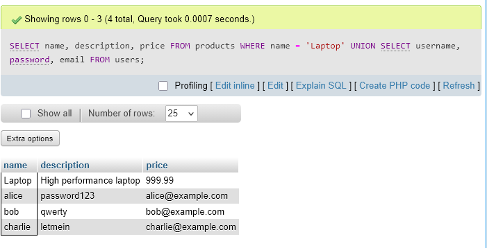
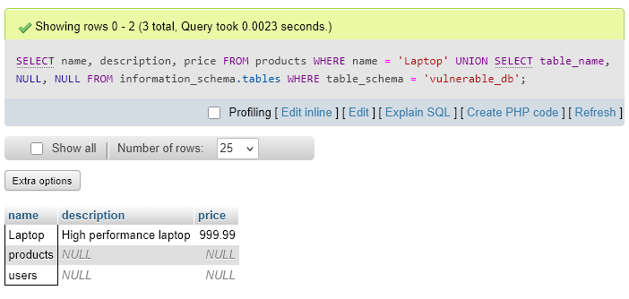

# SQL Injection Exploitation and Remediation — Application Security Investigation

## Executive Summary

This investigation documents an authorized SQL injection security exercise involving vulnerable database queries, information disclosure, and application-level remediation.

The investigation included examining SQL injection behavior, using UNION-based queries to retrieve database information, enumerating database structure, and independently testing vulnerable Python application code.

The independent security assessment extended the guided exercise by examining how unsafe SQL query construction could permit user-controlled input to alter database operations.

The remediation phase focused on parameterized queries and validation of the modified application behavior.

The objective was to demonstrate practical application security analysis, controlled vulnerability testing, secure database access, and evidence-based remediation.

## Investigation Scenario

A database-backed application processes user input and constructs SQL queries to retrieve information.

When an application incorporates untrusted input directly into SQL statements, an attacker may be able to manipulate the intended query structure.

The investigation examines this vulnerability class in an authorized training environment.

The guided exercises explore SQL injection techniques and their potential effects on database confidentiality.

The independent investigation focuses on identifying vulnerable query construction in Python and applying a safer database-query implementation.

This report documents the observed results of controlled testing rather than exploitation of a production application.

## Investigation Scope

| Component | Investigation Purpose |
| --- | --- |
| SQL database | Examine query execution and database responses |
| UNION-based SQL injection | Investigate unintended data extraction |
| Database schema enumeration | Identify accessible database structure |
| Python application code | Analyze vulnerable SQL query construction |
| User-controlled input | Examine how untrusted values affect queries |
| Parameterized queries | Separate SQL instructions from supplied data |
| Independent validation | Compare vulnerable and remediated behavior |
| Screenshot evidence | Support technical findings and conclusions |

### Investigation Objectives

1. Examine the SQL injection scenario and affected database operations.
2. Demonstrate UNION-based data extraction in the authorized environment.
3. Investigate database schema enumeration.
4. Identify the security implications of exposed database information.
5. Analyze vulnerable SQL query construction in Python.
6. Perform an independent SQL injection test.
7. Modify the vulnerable code using parameterized queries.
8. Compare observed behavior before and after remediation.
9. Document remaining limitations and applicable secure coding practices.

## Evidence Sources and Methodology

### Evidence Sources

The investigation uses four screenshots collected during the original IBM security exercises and independent testing.

The preserved project notes provide the scenario, exercise instructions, investigation activities, and observed results.

### Investigation Methodology

| Phase | Analyst Activity |
| --- | --- |
| Vulnerability analysis | Examine unsafe SQL query construction |
| Controlled exploitation | Test UNION-based SQL injection behavior |
| Information disclosure assessment | Review retrieved data and database structure |
| Independent testing | Evaluate vulnerable Python application code |
| Remediation | Apply parameterized database queries |
| Verification | Compare vulnerable and remediated results |
| Reporting | Document findings, security implications, and evidence limitations |

### Evidence Standards

All testing was conducted in an authorized lab environment.

The investigation distinguishes between the behavior demonstrated during testing and broader risks associated with SQL injection.

A successful SQL injection test does not independently establish that the same technique would work against other databases or applications.

Likewise, parameterizing the tested query does not establish that an entire application is free of SQL injection vulnerabilities.

The technical findings will be supported by the preserved screenshots and independent exercise documentation.

## Investigation Organization

The report will document four findings:

1. UNION-Based SQL Injection and Data Extraction
2. Database Schema Enumeration
3. Independent SQL Injection Exploitation
4. Parameterized Query Remediation and Validation

The final sections will summarize security implications, remediation outcomes, evidence limitations, skills demonstrated, and supporting screenshots.

## Investigation Findings

### Finding 1 — UNION-Based SQL Injection and Data Extraction

#### Investigation Context

The IBM SQL injection exercise simulated an online store with a product search feature backed by a MySQL database.

The lab environment contained two tables:

- `products` — Product names, descriptions, and prices.
- `users` — Usernames, passwords, and email addresses.

The objective was to demonstrate how unsafe SQL query construction could allow information from the `users` table to appear in a query intended to retrieve product information.

The exercise used the database `vulnerable_db` and the phpMyAdmin SQL interface.

#### Vulnerable Query Construction

The lab described a product search query that incorporated user-controlled input directly into a SQL statement:

```sql
SELECT * FROM products WHERE name = '$productName';
```

When untrusted input is concatenated into the SQL statement without proper parameterization, it can potentially change the intended query structure.

The lab supplied a UNION-based injection example that appended a second SELECT statement targeting the `users` table.

The preserved screenshot showed the following query executed in phpMyAdmin:

```sql
SELECT name, description, price
FROM products
WHERE name = 'Laptop'
UNION
SELECT username, password, email
FROM users;
```

The query combined three selected columns from the `products` table with three columns from the `users` table.

Both SELECT statements returned the same number of columns, allowing their results to be combined.

#### Observed Query Results

The screenshot displayed the message:

**Showing rows 0 - 3 (4 total, Query took 0.0007 seconds.)**

The results contained one product record and three user records.

| Result Type | First Column | Second Column | Third Column |
| --- | --- | --- | --- |
| Product | `Laptop` | High performance laptop | `999.99` |
| User | `alice` | `password123` | `alice@example.com` |
| User | `bob` | `qwerty` | `bob@example.com` |
| User | `charlie` | `letmein` | `charlie@example.com` |



*Figure 1 — phpMyAdmin results showing a UNION-based query combining product information with three user records from the `users` table.*

The displayed columns retained the labels `name`, `description`, and `price` from the first SELECT statement.

However, the later rows contained data from the `users` table.

As a result, the `description` column displayed passwords and the `price` column displayed email addresses for those rows.

The screenshot confirmed that the SQL statement returned user information alongside product information.

#### Security Impact Analysis

The result illustrated how UNION-based SQL injection can compromise database confidentiality when an application permits untrusted input to alter SQL statements.

A product lookup should not ordinarily expose authentication-related records from a separate user table.

In the demonstrated query, the UNION operation allowed data from `users` to appear in the product-query result set.

The lab's example database stored passwords in plaintext, increasing the sensitivity of the disclosed records.

A production application should store passwords using an appropriate password-hashing algorithm rather than plaintext.

The exercise also highlighted why database permissions matter.

An application database account should not possess unnecessary access to sensitive tables.

Restricting database privileges can limit the potential impact of certain injection vulnerabilities, although it does not replace secure query construction.

#### Evidence Interpretation

The preserved screenshot was captured from phpMyAdmin.

It directly established that the combined SQL query executed and returned four rows, including three records from the `users` table.

The screenshot did not show a browser-based product search form, an HTTP request carrying an injection payload, or the application's query-construction code.

Therefore, the observed result demonstrates the database behavior underlying the lab's UNION-based SQL injection scenario.

It should not be interpreted as independent proof of exploitation through a deployed web application's input field.

#### Analyst Assessment

**Assessment: UNION-based SQL query successfully returned user information alongside product data in the authorized MySQL lab.**

The query returned four rows, including one product record and three user records containing usernames, plaintext passwords, and email addresses.

This demonstrated the confidentiality impact that could result if a vulnerable application allowed user input to alter the intended product-search query.

The preserved screenshot confirms database query behavior; it does not independently establish application-level injection delivery.

The next finding examines database schema enumeration and the information that can be discovered about underlying database structures.

### Finding 2 — Database Schema Enumeration

#### Investigation Context

Following the UNION-based data extraction exercise, the next phase examined how database metadata could be retrieved using a similar SQL technique.

The objective was to identify database tables through the MySQL `INFORMATION_SCHEMA` metadata interface.

The exercise used the existing `vulnerable_db` database, containing the `products` and `users` tables.

The security concern was that knowledge of internal database structure could help an attacker identify potentially sensitive data sources.

#### Database Metadata Enumeration

MySQL provides the `INFORMATION_SCHEMA` database, which contains metadata describing database objects, including tables and columns.

The `information_schema.tables` view exposes information about database tables visible to the querying account.

The original exercise demonstrated how a UNION operation could combine ordinary application data with table names retrieved from this metadata view.

The preserved screenshot displayed the following statement in phpMyAdmin:

```sql
SELECT name, description, price
FROM products
WHERE name = 'Laptop'
UNION
SELECT table_name, NULL, NULL
FROM information_schema.tables
WHERE table_schema = 'vulnerable_db';
```

The first SELECT statement retrieved information from the `products` table.

The second SELECT statement retrieved table names from `information_schema.tables`, restricted to the `vulnerable_db` schema.

The UNION operator combined the two result sets.

Both SELECT statements returned three expressions, preserving column-count compatibility.

The two NULL expressions acted as placeholders for the second and third output columns.

#### Observed Enumeration Results

The phpMyAdmin interface displayed:

**Showing rows 0 - 2 (3 total, Query took 0.0023 seconds.)**

The query returned three rows:

| Result Type | Name | Description | Price |
| --- | --- | --- | --- |
| Product record | `Laptop` | High performance laptop | `999.99` |
| Database table | `products` | NULL | NULL |
| Database table | `users` | NULL | NULL |



*Figure 2 — phpMyAdmin showing a UNION-based query against `information_schema.tables`, revealing the `products` and `users` tables in database `vulnerable_db`.*

The first row contained the expected product information.

The remaining two rows disclosed table names from the target database.

The result demonstrated that metadata about the database structure could be included in the output of a query originally intended to retrieve product information.

The identified tables were:

- `products` — the application's product information table.
- `users` — the table containing user account information in the lab environment.

The screenshot did not display column names or the internal definitions of either table.

#### Security Impact Analysis

Database schema enumeration can assist an attacker in understanding how an application stores and organizes information.

Identifying a `users` table may indicate that authentication-related or account-related information is present in the database.

Knowledge of table names can inform additional testing for unauthorized data access.

In this exercise, enumeration was particularly relevant because Finding 1 demonstrated that the `users` table contained usernames, plaintext passwords, and email addresses.

Together, the two findings illustrated how an unsafe query interface could expose both database records and structural metadata.

However, knowing a table name does not automatically grant access to its contents.

The actual impact of SQL injection depends on the vulnerable query, database permissions, application behavior, and accessible database objects.

#### Evidence Interpretation

The screenshot was captured in phpMyAdmin, where the UNION-based SQL statement was executed directly.

It established that the query returned metadata identifying the `products` and `users` tables within `vulnerable_db`.

The screenshot did not independently show the SQL statement being injected through a web application input field.

It also did not establish that additional schemas, tables, or columns were enumerated.

The result therefore demonstrates database metadata disclosure through the executed SQL statement, consistent with the lab's SQL injection scenario.

#### Defensive Considerations

The exercise highlighted several important application security controls.

**Parameterized queries**

Applications should treat user-supplied values as data rather than allowing them to alter SQL syntax.

Proper parameterization is the primary remediation for SQL injection in supported query contexts.

**Least-privilege database access**

Application database accounts should receive only the permissions required for their intended operations.

Restricting unnecessary database access can reduce the impact of a successfully exploited vulnerability.

**Error and response handling**

Applications should avoid unnecessarily exposing internal database details in user-facing errors or responses.

However, suppressing errors alone does not prevent SQL injection.

**Secure application testing**

Security testing should examine whether user-controlled input can alter SQL query structure.

Database schema enumeration may be one indicator that a query is executing unintended SQL instructions.

#### Analyst Assessment

**Assessment: UNION-based SQL query disclosed the names of two tables in the authorized MySQL lab database.**

The preserved screenshot showed a successful query against `information_schema.tables`, restricted to schema `vulnerable_db`.

The output contained three rows: the original `Laptop` product record and the table names `products` and `users`.

This demonstrated how database metadata could be retrieved through a UNION-based query.

The screenshot confirmed direct database query execution, but did not independently prove injection through a deployed application's input field.

The next investigation phase examines independent testing against vulnerable Python application code.